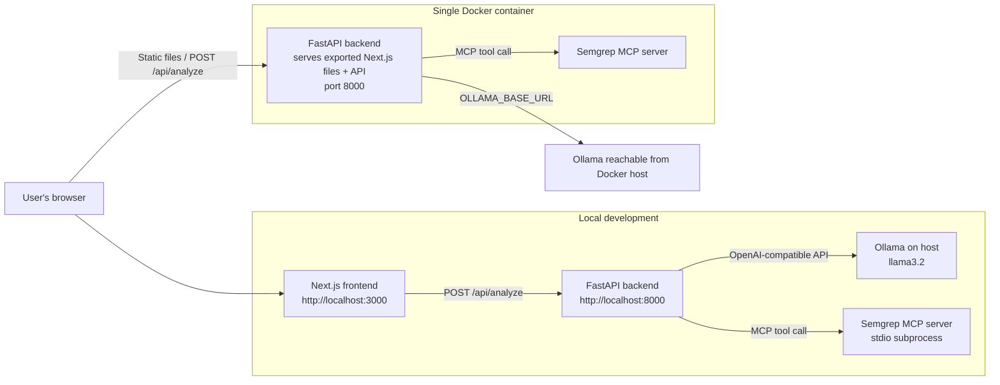

# Cybersecurity Analyzer

A web application that analyzes Python code for potential security vulnerabilities. It combines an AI security researcher powered by a locally hosted Ollama model with Semgrep scanning through the Semgrep MCP server, then presents the results in a browser.

> **Important:** This tool supports security review and education. It can miss vulnerabilities or report incorrect findings. Review results with a qualified person and do not treat them as a substitute for a complete security assessment.

## Features

- Upload and analyze Python (`.py`) files in a web interface.
- Combine Semgrep findings with AI-assisted security analysis.
- Return a structured summary and findings, including severity, CVSS score, affected code, and a recommended fix.
- Sort findings from highest to lowest CVSS score.
- Run locally with separate frontend and backend processes, or as a single Docker container.
- Use an OpenAI-compatible local model endpoint; the default is Ollama with `llama3.2`.

## Architecture



During local development, Next.js runs separately from FastAPI. In the production Docker image, the frontend is exported as static files and served by FastAPI, so the browser uses one origin and the container exposes port `8000`. Ollama and the Semgrep MCP process are not the same thing: Semgrep is launched by the backend, while Ollama runs separately and serves the language model.

## Requirements

- Git
- Node.js 20 or newer and npm
- Python 3.12 or newer
- [`uv`](https://docs.astral.sh/uv/)
- [Ollama](https://ollama.com/) with the `llama3.2` model
- A Semgrep App token for Semgrep scanning
- Docker Desktop or Docker Engine, if using Docker

## Configuration

Create a `.env` file in the repository root:

```dotenv
SEMGREP_APP_TOKEN=your-semgrep-app-token
```

Do not commit `.env` or real credentials to Git. The repository's `.gitignore` excludes environment files.

| Variable | Required | Purpose |
| --- | --- | --- |
| `SEMGREP_APP_TOKEN` | Yes | Passed to the Semgrep MCP server for scanning. |
| `OLLAMA_BASE_URL` | No | OpenAI-compatible Ollama API URL. Defaults to `http://localhost:11434/v1` for a backend running directly on your computer. |
| `ENVIRONMENT` | No | Set to `production` to enable the production CORS configuration. |

The OpenAI-compatible client uses a placeholder API key for Ollama; this app's current model configuration does not require `OPENAI_API_KEY`. A message saying `OPENAI_API_KEY is not set, skipping trace export` concerns optional trace export, not the Ollama model connection.

The model name is currently configured as `llama3.2` in `backend/server.py`. Download it before running analysis:

```bash
ollama pull llama3.2
```

## Run locally

Start Ollama and make sure the model is available. Then start the backend:

```bash
cd backend
uv sync
uv run server.py
```

In a second terminal, start the frontend:

```bash
cd frontend
npm ci
npm run dev
```

Open [http://localhost:3000](http://localhost:3000). The development frontend sends analysis requests to the backend at `http://localhost:8000`. The backend health endpoint is [http://localhost:8000/health](http://localhost:8000/health), and FastAPI's interactive API docs are at [http://localhost:8000/docs](http://localhost:8000/docs).

## Run with Docker

Build the image from the repository root:

```bash
docker build -t cyber-analyzer .
```

Run the container:

```bash
docker run --rm -d --name cyber-analyzer -p 8000:8000 --add-host=host.docker.internal:host-gateway --env-file .env cyber-analyzer
```

Open [http://localhost:8000](http://localhost:8000). Check that the API is ready:

```bash
docker ps
docker logs cyber-analyzer
curl http://localhost:8000/health
```

Stop the container:

```bash
docker stop cyber-analyzer
```

The Docker image sets `OLLAMA_BASE_URL` to `http://host.docker.internal:11434/v1`, which lets the container reach Ollama running on the host. The `--add-host` option provides this host name on Linux Docker Engine; Docker Desktop generally provides it already. Make sure Ollama is running and accessible from Docker, and that `llama3.2` has been pulled. If Ollama is on another machine or port, set `OLLAMA_BASE_URL` to its reachable OpenAI-compatible API URL with `-e OLLAMA_BASE_URL=...`.

> **Network security:** Ollama must accept connections from the Docker container for analysis to work. Only enable the minimum network access needed; do not expose an unauthenticated Ollama endpoint to untrusted networks. Docker does not package or start Ollama.

## API

### `GET /health`

Returns a simple health response:

```json
{
  "message": "Cybersecurity Analyzer API"
}
```

### `POST /api/analyze`

Request:

```json
{
  "code": "import pickle\n..."
}
```

The response contains a `summary` and an `issues` array. Each issue includes:

```json
{
  "title": "Example finding",
  "description": "Why the code may be vulnerable and its potential impact.",
  "code": "vulnerable_code()",
  "fix": "Use a safer alternative.",
  "cvss_score": 7.5,
  "severity": "high"
}
```

An empty or whitespace-only `code` value is rejected with HTTP `400`. Analysis failures are returned as HTTP `500`.

## Project layout

```text
.
├── backend/
│   ├── server.py          # FastAPI application and AI analysis flow
│   ├── context.py         # Agent instructions and analysis prompts
│   ├── mcp_servers.py     # Semgrep MCP server configuration
│   ├── pyproject.toml     # Python dependencies
│   └── uv.lock            # Locked Python dependency versions
├── frontend/
│   ├── src/app/           # Next.js application
│   └── package.json       # Frontend scripts and dependencies
├── terraform/
│   ├── azure/             # Azure infrastructure configuration
│   └── gcp/               # Google Cloud infrastructure configuration
├── Dockerfile             # Multi-stage frontend build and single-container app
└── README.md
```

## Deployment notes

The repository contains Terraform configurations for Azure Container Apps and Google Cloud Run. The current application expects an Ollama-compatible model endpoint. A cloud deployment must provide an `OLLAMA_BASE_URL` reachable from the container and must account for the resources and network access required by both Ollama and Semgrep. The local Docker default (`host.docker.internal`) is intended for a developer's machine and is not a cloud model-hosting solution.

Review and adapt the Terraform environment variables and secret handling before deploying. In particular, do not assume that the checked-in cloud configuration is fully aligned with the current Ollama-based backend.

## Development checks

Frontend lint:

```bash
cd frontend
npm run lint
```

Backend dependency sync:

```bash
cd backend
uv sync
```

## Contributing

Bug reports, fixes, and educational contributions are welcome. Please avoid including API tokens, credentials, or private code in issues and pull requests.
